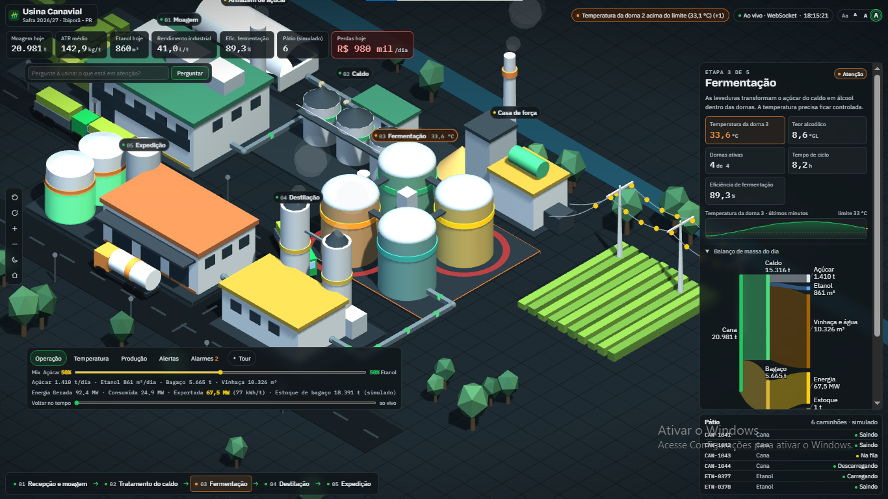
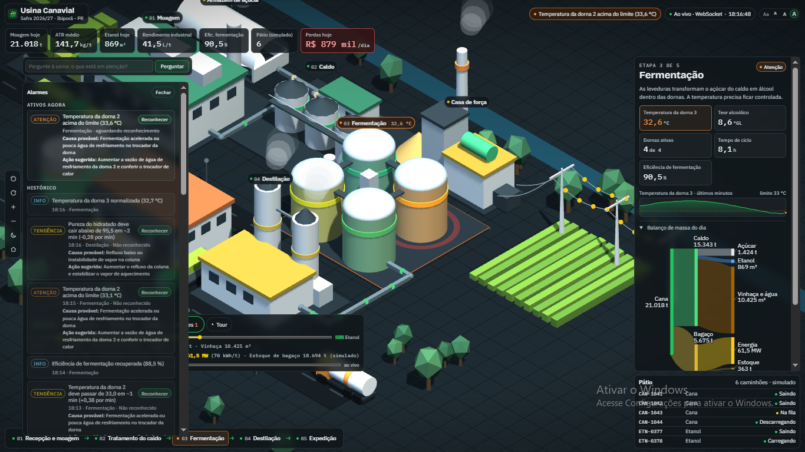
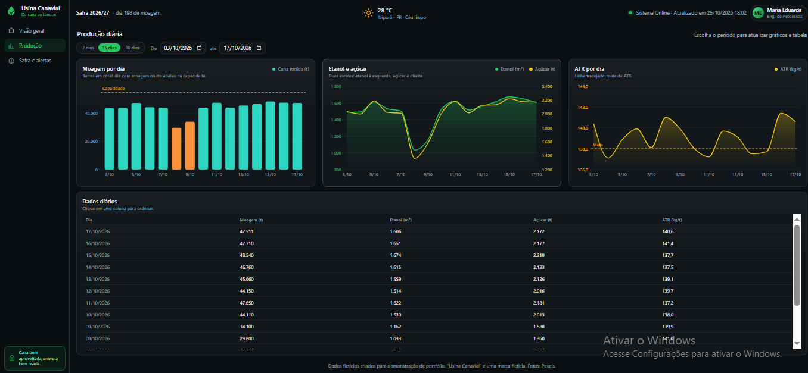
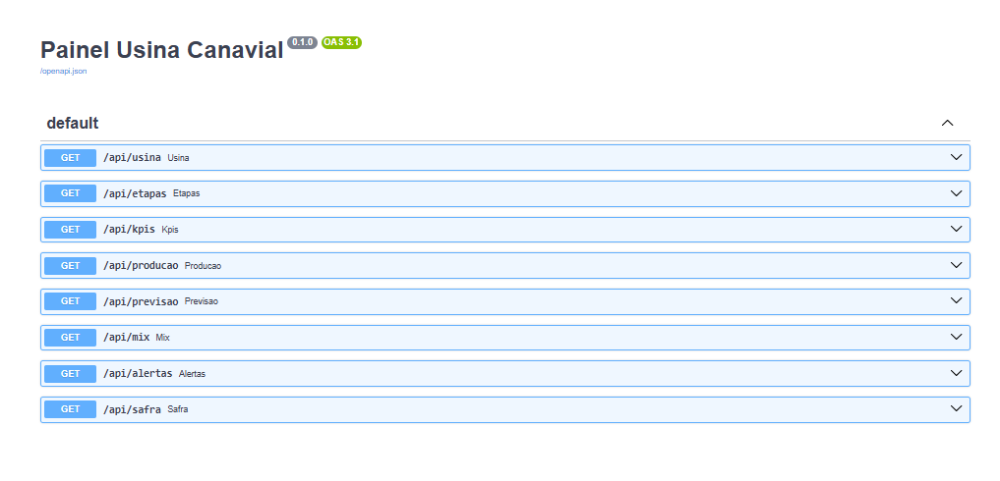
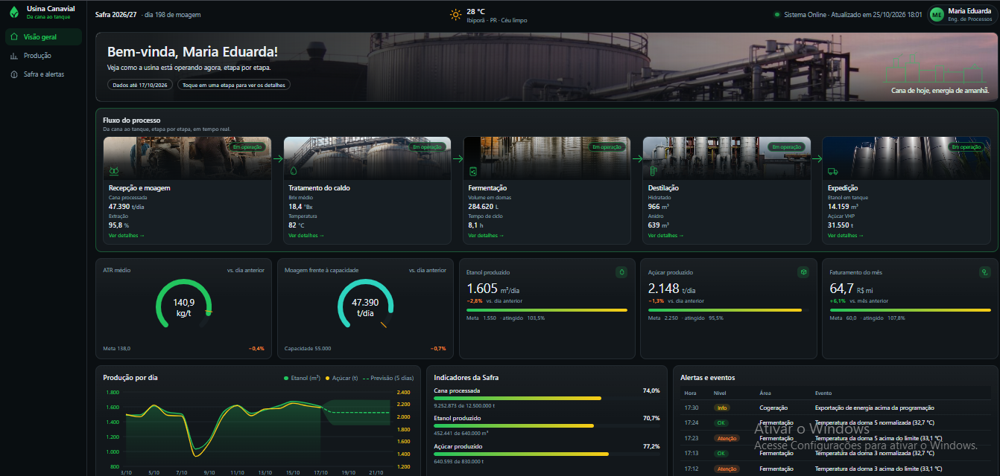

# Usina Canavial — Painel 3D de Operação em Tempo Real

Painel web em vista 3D isométrica que acompanha uma usina de cana-de-açúcar, da moagem à expedição. A cena, os indicadores e os alarmes são alimentados por uma API real (FastAPI + SQLite) e por um simulador. O painel 2D original continua disponível em `/2d`.


*Vista geral da usina em 3D, com a casa de força e a linha de transmissão, o contador de perdas em R$/dia no topo e o Sankey do balanço de massa no painel lateral.*


*Lista de alarmes com causa provável e ação sugerida em cada item (limite e tendência), com a dorna em alerta de temperatura na cena e no painel.*


*Previsão de etanol para os próximos 5 dias, com intervalo de confiança de 80%.*


*Documentação interativa da API (Swagger), gerada pelo FastAPI.*

> **Aviso:** todos os dados são **fictícios**, criados apenas para demonstração de portfólio. "Usina Canavial" é uma marca fictícia.

## Funcionalidades do painel 3D

**Cena e operação**

- **Cena 3D isométrica** (Three.js) com as cinco etapas, tubulações, pátio de caminhões, modo noite e câmera livre (arrastar, girar, zoom).
- **Camadas de dados:** Operação, Temperatura (leitura dividida pelo limite da etapa), Produção (produção real dividida pela capacidade nominal) e Alertas.
- **Cena guiada pelos dados:** a fumaça fica mais densa quando a moagem passa de 90% da capacidade; os pontos nas tubulações andam proporcionalmente à vazão do caldo (e dividem-se entre etanol e açúcar conforme o mix); o tanque de etanol mostra o estoque; a quantidade de caminhões de cana segue a fila da recepção.
- **Painel da etapa** com indicadores, gráfico dos últimos minutos e, na Expedição, a previsão de etanol de 5 dias e o estoque projetado.
- **Indicadores do setor:** rendimento industrial, eficiência de fermentação, eficiência de extração e perdas totais, calculados pelo simulador de forma coerente com a moagem.
- **Pergunte à usina:** caixa de texto com respostas por regras e palavras-chave lendo o banco (sem serviços externos). A câmera foca a etapa citada.
- **Voltar no tempo:** controle deslizante de até 120 minutos que mostra painel e KPIs gravados, com a etiqueta "histórico" e o botão "Voltar ao vivo".
- **Clique no caminhão:** cartão com ID, tipo, carga, destino e ETA (dados simulados no navegador, rotulados).
- **Tour guiado** com legendas.
- **Tempo real por WebSocket** (`/ws`), com volta automática para a consulta a cada 10 segundos e, se a API cair, para os dados de exemplo.

**Mix e balanço de massa**

- **Mix açúcar/etanol:** controle deslizante (% do ATR recuperado destinado ao açúcar; padrão 50%). O ATR da cana se divide entre açúcar e etanol (hidratado e anidro) por esse mix; a mudança vale para o simulador, os KPIs e as tubulações.
- **Balanço de massa do dia:** a partir da moagem, do ATR, das perdas e do mix, a API calcula açúcar (VHP e cristal), etanol, bagaço (27% da cana) e vinhaça (12 L por litro de etanol).
- **Sankey do balanço de massa** no painel lateral: cana → caldo e bagaço → açúcar, etanol, vinhaça e água, energia e sobra de bagaço (altura = massa em t/dia). Clique no diagrama para ampliar; Esc fecha.

**Cogeração**

- **Cogeração com bagaço:** o bagaço queimado vira vapor e energia no turbogerador; o painel mostra energia gerada, consumida e exportada (MW e kWh por tonelada de cana). A cena tem a pilha de bagaço, a caldeira com chaminé, a casa de força e a linha de transmissão, com pulsos proporcionais à energia exportada.
- **Estoque de bagaço (simulado):** o valor do pátio aparece no painel com o rótulo "simulado" porque, na demonstração, o tempo do estoque é **acelerado 1.440 vezes** (1 minuto = 1 dia), para a pilha subir e descer durante a demo. No mundo real o estoque varia ao longo de dias.

**Alarmes e gestão**

- **Gestão de alarmes:** prioridade (crítico, atenção, info), botão **Reconhecer**, histórico e tempo até o reconhecimento.
- **Alarme por tendência:** a API ajusta uma reta às leituras dos últimos 2 minutos de cada sensor com limite e avisa quando o limite deve ser cruzado em até 10 minutos (descarta inclinações que são só ruído). Todo alarme, de tendência ou de limite, traz **causa provável** e **ação sugerida**.
- **Dornas no 3D:** cor em gradiente térmico (azul frio, verde, amarelo, vermelho) e anel pulsante no chão: amarelo = tendência de passar do limite, vermelho = acima do limite. No simulador a dorna 2 deriva devagar, para a tendência aparecer minutos antes do limite.
- **Perdas em R$/dia:** o ATR perdido (perdas totais x ATR da cana) é valorado pelo mix e aparece como contador em destaque no topo (a dica mostra a parte acima do plano e a receita estimada). Os preços de açúcar (R$/t), etanol (R$/m³) e energia (R$/MWh) ficam num só lugar: `dados-exemplo/precos.json`.
- **Evento de chuva** no simulador (em média a cada ~14 minutos, por 2,5 a 4 minutos, ou na hora com `python simulador.py --chuva-ja`): a moagem cai para 60% e a fila de caminhões diminui; o 3D mostra gotas e cena mais escura, e o painel avisa. Some sozinho.

## Painel 2D (versão anterior)

A versão 2D continua disponível em `/2d`, com KPIs, produção diária, previsão, mix de ATR e progresso da safra.



## Tecnologias

- **Python**, **FastAPI** (REST e WebSocket) e **Uvicorn**
- **SQLAlchemy** e **SQLite**
- **statsmodels** e **pandas** (previsão por ETS)
- **Three.js r128** (cena 3D) e **D3.js** (gráficos do painel 2D), ambos via CDN

## Arquitetura

```
┌───────────┐ grava a cada 10 s ┌──────────┐ SQLAlchemy ┌────────────┐ REST /api/*, WebSocket /ws ┌──────────────────┐
│ simulador │ ────────────────► │  banco   │ ─────────► │    API     │ ─────────────────────────► │ painel 3D  (/)   │
│ (Python)  │                   │ (SQLite) │            │ (FastAPI)  │                            │ painel 2D  (/2d) │
└───────────┘                   └──────────┘            └────────────┘                            └──────────────────┘
```

| Arquivo | Papel |
| --- | --- |
| `simulador.py` | Gera leituras, indicadores do setor, balanço de massa, cogeração, evento de chuva, histórico de safra e alarmes (limite e tendência) |
| `banco.py` | Modelos, limites de temperatura, capacidades, regras de alarme, causas e ações, tendência, balanço de massa, cogeração, perdas em R$, Sankey e criação do banco |
| `main.py` | Rotas `/api/*`, `/ws`, pergunte à usina e entrega das páginas |
| `previsao.py` | Previsão de etanol (ETS) |
| `index.html` | Painel 3D (rota `/`) |
| `painel2d.html` | Painel 2D original (rota `/2d`) |
| `img-*.js` | Imagens em base64 usadas apenas pelo painel 2D (`/2d`) |
| `dados-exemplo/` | JSONs de partida (inclui `precos.json`), formato de referência e fallback |

Rotas da API (documentação interativa em `/docs`):

| Rota | O que devolve |
| --- | --- |
| `/api/usina`, `/api/etapas`, `/api/kpis` | Dados da usina, das cinco etapas e dos KPIs |
| `/api/cena` | Tudo o que a cena 3D usa: temperaturas e limites, produção e capacidade, alertas ativos (limite e tendência, com causa e ação), estado das dornas, balanço, energia, perdas em R$, Sankey e chuva |
| `/api/indicadores`, `/api/safra`, `/api/producao` | Indicadores do setor, progresso da safra e produção diária |
| `/api/alarmes`, `/api/alertas` | Histórico de alarmes e os mais recentes |
| `POST /api/alertas/{id}/reconhecer` | Reconhece um alarme |
| `/api/historico?minutos=N&detalhe=true` | Série recente dos sensores e, com `detalhe`, um instantâneo por minuto |
| `/api/previsao` | Previsão de etanol (ETS) |
| `/api/mix` | Participação de cada produto no mix |
| `GET` e `PUT /api/mix/acucar` | Lê e altera o mix (percentual do ATR para açúcar) |
| `/api/balanco` | Balanço de massa do dia (ATR, açúcar, etanol, bagaço, vinhaça) |
| `/api/energia` | Cogeração: bagaço queimado, vapor, energia gerada, consumida e exportada (MW e kWh/t) e estoque de bagaço (simulado) |
| `/api/financeiro` | Perdas em R$/dia, receita estimada e os preços usados |
| `/api/chuva` | Se há chuva simulada e quantos segundos faltam |
| `POST /api/perguntar` | Pergunte à usina |
| `/ws` | WebSocket com o mesmo pacote da consulta, a cada 10 s |

## Como rodar

Pré-requisito: Python 3.10 ou superior. O Three.js e o D3.js vêm de CDN, então é preciso internet. O banco `usina_canavial.db` é criado automaticamente na primeira execução.

**1. Ambiente e bibliotecas**

```bash
python -m venv .venv

# Windows (PowerShell)
.venv\Scripts\Activate.ps1
# Linux / macOS
source .venv/bin/activate

pip install -r requirements.txt
```

**2. Terminal 1 — simulador**

```bash
python simulador.py
```

Opções: `--intervalo 2` (ciclo mais rápido), `--ciclos 5` (faz 5 ciclos e sai) e `--chuva-ja` (começa com uma chuva de 3 minutos, para ver o efeito sem esperar o sorteio).

**3. Terminal 2 — API (porta 8001)**

```bash
python -m uvicorn main:app --port 8001
```

Abra <http://127.0.0.1:8001> para o painel 3D e <http://127.0.0.1:8001/2d> para o 2D. A documentação da API fica em <http://127.0.0.1:8001/docs>. Use a porta 8001 para não conflitar com outra instância na 8000.

## Limitações

- Todos os dados são fictícios.
- **Preços, eficiências e chuva são simulados:** os preços de `dados-exemplo/precos.json` são valores de exemplo (o KPI de faturamento é ilustrativo e não é calculado a partir deles), as eficiências seguem fórmulas simplificadas do simulador e a chuva é sorteada, não vem de previsão do tempo.
- **O estoque de bagaço é acelerado** (1 minuto = 1 dia) na demonstração e por isso aparece rotulado como "simulado" no painel.
- O balanço de massa e a cogeração usam fatores médios simplificados (ver o código em `banco.py`), não o projeto de uma usina real.
- A fila e o pátio de caminhões do navegador são simulados no próprio painel.
- A API não tem autenticação: é para uso local de demonstração.
- Ainda não há testes automatizados.

## Glossário

- **ATR (Açúcares Totais Recuperáveis):** açúcar da cana que pode ser recuperado no processo, em kg por tonelada de cana.
- **Brix:** percentual de sólidos solúveis (principalmente açúcares) no caldo.
- **Moagem:** etapa em que a cana é esmagada para extrair o caldo; medida em toneladas de cana por dia.
- **Dornas:** tanques onde o caldo é fermentado para produzir etanol (quatro nesta usina).
- **Rendimento industrial:** litros de etanol produzidos por tonelada de cana processada (L/t). Nesta simulação fica perto de 80 L/t.
- **Eficiência de fermentação:** percentual do açúcar do caldo que as leveduras realmente convertem em etanol. Cai quando a temperatura da dorna passa do limite.
- **Eficiência de extração:** percentual do açúcar da cana que sai no caldo nas moendas.
- **Perdas totais:** parte do açúcar que não vira etanol, somando extração, fermentação e destilação.
- **Capacidade nominal:** volume máximo que a etapa processa; a camada Produção compara a produção real com ele.
- **Reconhecer (alarme):** o operador confirma que viu o alarme; o painel registra o tempo até o reconhecimento.
- **Alarme por tendência:** aviso antecipado: a inclinação das leituras dos últimos minutos indica que o valor vai cruzar o limite em breve, antes de o alarme de limite disparar.
- **Mix açúcar/etanol:** como o ATR recuperado é dividido entre a fabricação de açúcar e a de etanol (em % do ATR).
- **Cogeração:** produção de vapor e de energia elétrica a partir da queima do bagaço; a usina consome parte da energia e exporta o resto à rede.
- **Bagaço:** fibra que sobra da cana depois da moagem (cerca de 27% do peso da cana); é o combustível da caldeira.
- **Vinhaça:** resíduo líquido da destilação do etanol (cerca de 12 litros por litro de etanol), usado como fertilizante na lavoura.
- **kWh/t:** quilowatts-hora de energia por tonelada de cana processada; mede quanta energia se gera, consome ou exporta por tonelada.

## Decisões técnicas

- **FastAPI:** gera documentação interativa e suporta REST e WebSocket no mesmo app.
- **SQLite via SQLAlchemy:** não exige servidor e permite trocar para PostgreSQL com poucas mudanças.
- **ETS:** modelo simples e rápido para séries diárias, com intervalo de confiança.
- **WebSocket com fallback:** o servidor envia o mesmo pacote da consulta a cada 10 s; se a conexão cair, o painel volta sozinho à consulta e, sem API, aos dados de exemplo.
- **Pergunte à usina por regras:** palavras-chave sobre o banco, sem serviço externo nem chave de API.
- **Tendência por regressão linear:** uma reta de mínimos quadrados sobre os últimos 2 minutos, com exigência de ajuste (R² mínimo) para ignorar ruído e horizonte de 10 minutos. É simples, explicável e não precisa de treinamento.
- **Balanço de massa por ATR:** o ATR recuperado se divide entre açúcar e etanol pelo mix, com fatores de conversão fixos; só o que passa (ou falta) das perdas de planejamento (13,4%) altera o resultado.
- **Estoque de bagaço acelerado:** o simulador evolui o estoque 1.440 vezes mais rápido que o real para a demo mostrar subida e descida; por honestidade, o painel o rotula como "simulado".
- **Preços em um só arquivo:** `dados-exemplo/precos.json` concentra açúcar, etanol e energia; a API o lê a cada consulta, então basta editar o arquivo.
- **Chuva compartilhada pelo banco:** o simulador grava o instante final da chuva num parâmetro (`chuva_fim`) e a API só o lê; assim os dois processos ficam desacoplados.
- **Sankey em massa:** as alturas são toneladas por dia (etanol a 0,8 t/m³); a vinhaça e a água aparecem como o que sobra do caldo, para a massa fechar.
- **SQLite em modo WAL:** o simulador grava enquanto a API lê.

## Próximos passos

- Demonstração online (hospedagem pública do painel e da API).
- Testes automatizados para as rotas, as regras de alarme e o simulador.
- Empacotamento com Docker (e troca do SQLite por PostgreSQL).
- Paleta de comandos com Ctrl+K para buscar etapas, alarmes e perguntas.
- Notificações de alarmes críticos (e-mail ou mensagem) e autenticação.

## Autora

Maria Eduarda Kassa — [LinkedIn](https://www.linkedin.com/in/maria-eduarda-kassa)

## Licença

Distribuído sob a licença MIT. Veja o arquivo [LICENSE](LICENSE).
