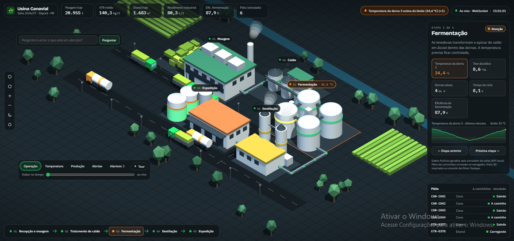
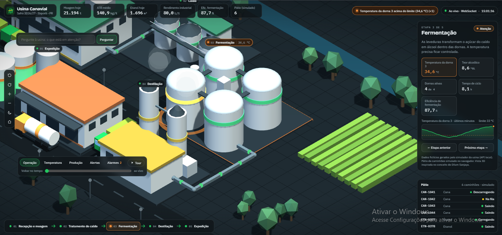
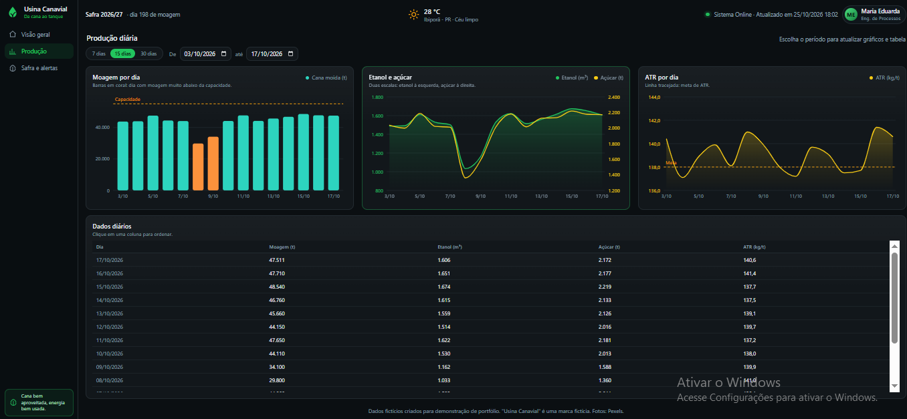
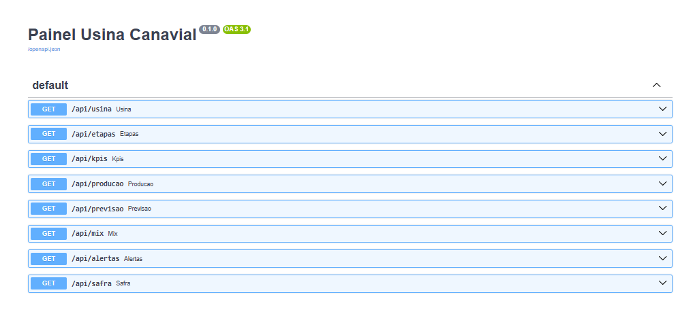
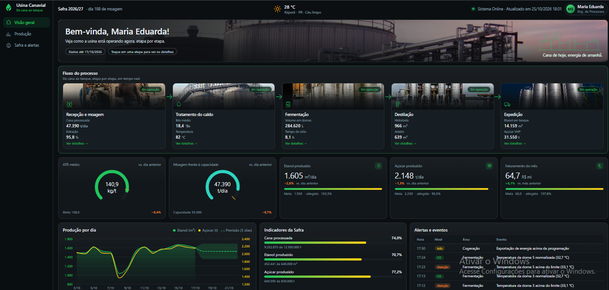

# Usina Canavial — Painel 3D de Operação em Tempo Real

Painel web em vista 3D isométrica que acompanha uma usina de cana-de-açúcar, da moagem à expedição. A cena, os indicadores e os alarmes são alimentados por uma API real (FastAPI + SQLite) e por um simulador. O painel 2D original continua disponível em `/2d`.


*Vista 3D da usina com alerta da dorna 3.*


*Detalhe da fermentação: dorna 3 acima do limite de temperatura.*


*Previsão de etanol para os próximos 5 dias, com intervalo de confiança de 80%.*


*Documentação interativa da API (Swagger), gerada pelo FastAPI.*

> **Aviso:** todos os dados são **fictícios**, criados apenas para demonstração de portfólio. "Usina Canavial" é uma marca fictícia.

## Funcionalidades do painel 3D

- **Cena 3D isométrica** (Three.js) com as cinco etapas, tubulações, pátio de caminhões, modo noite e câmera livre (arrastar, girar, zoom).
- **Camadas de dados:** Operação, Temperatura (leitura dividida pelo limite da etapa), Produção (produção real dividida pela capacidade nominal) e Alertas.
- **Cena guiada pelos dados:** a fumaça fica mais densa quando a moagem passa de 90% da capacidade; os pontos nas tubulações andam proporcionalmente à vazão do caldo; o tanque de etanol mostra o estoque; a quantidade de caminhões de cana segue a fila da recepção.
- **Painel da etapa** com indicadores, gráfico dos últimos minutos e, na Expedição, a previsão de etanol de 5 dias e o estoque projetado.
- **Indicadores do setor:** rendimento industrial, eficiência de fermentação, eficiência de extração e perdas totais, calculados pelo simulador de forma coerente com a moagem.
- **Gestão de alarmes:** prioridade (crítico, atenção, info), botão **Reconhecer**, histórico e tempo até o reconhecimento.
- **Pergunte à usina:** caixa de texto com respostas por regras e palavras-chave lendo o banco (sem serviços externos). A câmera foca a etapa citada.
- **Voltar no tempo:** controle deslizante de até 120 minutos que mostra painel e KPIs gravados, com a etiqueta "histórico" e o botão "Voltar ao vivo".
- **Clique no caminhão:** cartão com ID, tipo, carga, destino e ETA (dados simulados no navegador, rotulados).
- **Tour guiado** com legendas.
- **Tempo real por WebSocket** (`/ws`), com volta automática para a consulta a cada 10 segundos e, se a API cair, para os dados de exemplo.

## Painel 2D (versão anterior)

A versão 2D continua disponível em `/2d`, com KPIs, produção diária, previsão, mix de ATR e progresso da safra.



## Tecnologias

- **Python**, **FastAPI** (REST e WebSocket) e **Uvicorn**
- **SQLAlchemy** e **SQLite**
- **statsmodels** e **pandas** (previsão por ETS)
- **Three.js r128** (cena 3D) e **D3.js** (gráficos do painel 2D), ambos via CDN

## Arquitetura

```
┌───────────┐ grava a cada 10 s ┌──────────┐ SQLAlchemy ┌────────────┐ REST /api/*, WebSocket /ws ┌──────────────────┐
│ simulador │ ────────────────► │  banco   │ ─────────► │    API     │ ─────────────────────────► │ painel 3D  (/)   │
│ (Python)  │                   │ (SQLite) │            │ (FastAPI)  │                            │ painel 2D  (/2d) │
└───────────┘                   └──────────┘            └────────────┘                            └──────────────────┘
```

| Arquivo | Papel |
| --- | --- |
| `simulador.py` | Gera leituras, indicadores do setor, histórico de safra e alarmes |
| `banco.py` | Modelos, limites de temperatura, capacidades, regras de alarme e criação do banco |
| `main.py` | Rotas `/api/*`, `/ws`, pergunte à usina e entrega das páginas |
| `previsao.py` | Previsão de etanol (ETS) |
| `index.html` | Painel 3D (rota `/`) |
| `painel2d.html` | Painel 2D original (rota `/2d`) |
| `img-*.js` | Imagens em base64 usadas apenas pelo painel 2D (`/2d`) |
| `dados-exemplo/` | JSONs de partida, formato de referência e fallback |

Rotas principais: `/api/etapas`, `/api/kpis`, `/api/cena`, `/api/indicadores`, `/api/alarmes`, `POST /api/alertas/{id}/reconhecer`, `/api/historico?minutos=N&detalhe=true`, `/api/previsao`, `POST /api/perguntar` e `/ws`.

## Como rodar

Pré-requisito: Python 3.10 ou superior. O Three.js e o D3.js vêm de CDN, então é preciso internet. O banco `usina_canavial.db` é criado automaticamente na primeira execução.

**1. Ambiente e bibliotecas**

```bash
python -m venv .venv

# Windows (PowerShell)
.venv\Scripts\Activate.ps1
# Linux / macOS
source .venv/bin/activate

pip install -r requirements.txt
```

**2. Terminal 1 — simulador**

```bash
python simulador.py
```

Opções: `--intervalo 2` (ciclo mais rápido) e `--ciclos 5` (faz 5 ciclos e sai).

**3. Terminal 2 — API (porta 8001)**

```bash
python -m uvicorn main:app --port 8001
```

Abra <http://127.0.0.1:8001> para o painel 3D e <http://127.0.0.1:8001/2d> para o 2D. A documentação da API fica em <http://127.0.0.1:8001/docs>. Use a porta 8001 para não conflitar com outra instância na 8000.

## Limitações

- Todos os dados são fictícios.
- A API não tem autenticação: é para uso local de demonstração.
- Ainda não há testes automatizados.

## Glossário

- **ATR (Açúcares Totais Recuperáveis):** açúcar da cana que pode ser recuperado no processo, em kg por tonelada de cana.
- **Brix:** percentual de sólidos solúveis (principalmente açúcares) no caldo.
- **Moagem:** etapa em que a cana é esmagada para extrair o caldo; medida em toneladas de cana por dia.
- **Dornas:** tanques onde o caldo é fermentado para produzir etanol (quatro nesta usina).
- **Rendimento industrial:** litros de etanol produzidos por tonelada de cana processada (L/t). Nesta simulação fica perto de 80 L/t.
- **Eficiência de fermentação:** percentual do açúcar do caldo que as leveduras realmente convertem em etanol. Cai quando a temperatura da dorna passa do limite.
- **Eficiência de extração:** percentual do açúcar da cana que sai no caldo nas moendas.
- **Perdas totais:** parte do açúcar que não vira etanol, somando extração, fermentação e destilação.
- **Capacidade nominal:** volume máximo que a etapa processa; a camada Produção compara a produção real com ele.
- **Reconhecer (alarme):** o operador confirma que viu o alarme; o painel registra o tempo até o reconhecimento.

## Decisões técnicas

- **FastAPI:** gera documentação interativa e suporta REST e WebSocket no mesmo app.
- **SQLite via SQLAlchemy:** não exige servidor e permite trocar para PostgreSQL com poucas mudanças.
- **ETS:** modelo simples e rápido para séries diárias, com intervalo de confiança.
- **WebSocket com fallback:** o servidor envia o mesmo pacote da consulta a cada 10 s; se a conexão cair, o painel volta sozinho à consulta e, sem API, aos dados de exemplo.
- **Pergunte à usina por regras:** palavras-chave sobre o banco, sem serviço externo nem chave de API.

## Próximos passos

- Demonstração online (hospedagem pública do painel e da API).
- Testes automatizados para as rotas, as regras de alarme e o simulador.
- Empacotamento com Docker (e troca do SQLite por PostgreSQL).
- Paleta de comandos com Ctrl+K para buscar etapas, alarmes e perguntas.
- Notificações de alarmes críticos (e-mail ou mensagem) e autenticação.

## Autora

Maria Eduarda Kassa — [LinkedIn](https://www.linkedin.com/in/maria-eduarda-kassa)

## Licença

Distribuído sob a licença MIT. Veja o arquivo [LICENSE](LICENSE).
